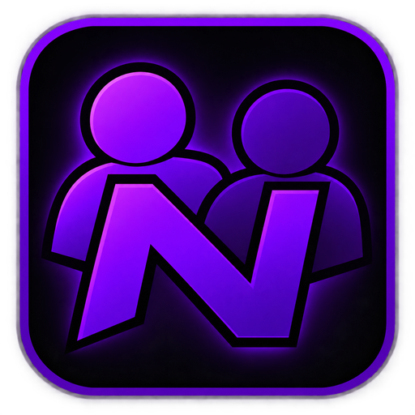

<div align="center">



# NexLevel

### Create Together. Build Beyond.

**Real-time collaborative level editing for Geometry Dash.**
Build the same level with your friends, at the same time, from anywhere.


by **Forg3 Studios**

</div>

> **Status:** v1.0.0 is in testing. If something doesn't work, please [open an issue](../../issues).

---

## ✨ What it does

Open a level in the editor, press **Host room**, send your friends a short code. They join and you're
all building together: every block, colour, trigger and setting shows up for everyone, live.

No IP addresses, no port forwarding, no router settings. It works on home Wi-Fi, school networks
and mobile data.

## 🎮 Features

- **🧱 A shared editor.** Objects, triggers, groups, colours, background, ground, song and start options
  all sync live. Undo, copy-paste and select-all work too.
- **🎨 See each other.** Every player gets their own colour, and a frame with their name shows where they
  are working.
- **▶️ Watch playtests live.** When someone playtests, everyone else sees their icon play through
  the level in the editor (cube, ship, ball, wave and the rest), leaving a trail in their colour.
- **🔑 Rooms with short codes.** Up to 16 players. The host can kick players or close the room.
  Players reconnect on their own if the connection drops, and very large levels load in seconds.
- **💾 Your work is never lost.** Autosave every 90 seconds while the room changes, even while the host
  is in the menus. Every player keeps a backup copy, and the host can run the room on a safe copy of
  their level.
- **🌍 Works on any network.** The fastest relay is picked automatically. Direct connections (UPnP) and
  local network are used when they're possible.
- **🔒 End-to-end encrypted.** Relays only ever see encrypted data.
- **📶 Connection info.** The NexLevel menu shows each player's ping, a live ping chart, the
  connection quality (Demon → Bad) and a link to each player's GD profile.

## 📥 Install

1. Install [Geode](https://geode-sdk.org) for Geometry Dash **2.2081**.
2. Install **NexLevel** from the Geode mod list, or download `forg3studios.nexlevel.geode` from
   [Releases](../../releases) and put it in `Geometry Dash/geode/mods`.
3. Restart the game.

> Everyone in a room needs the same Geometry Dash version and the same NexLevel version.

## 🚀 How to use

**Host a room**
1. Open your level in the editor.
2. Press **Esc** → **NexLevel Collab** → **Host room**.
3. Choose **This level**, or **A copy** to keep your original untouched.
4. Press **Copy** and send the code to your friends.

**Join a room**
- From the **main menu**: tap the **NexLevel logo** (top right), paste the code and press **Join**. The
  room opens in a new level, so your own levels are never touched.
- Or from inside the editor: **Esc** → **NexLevel Collab** → paste the code → **Join**.

## ❓ FAQ

**Do I need to open ports or share my IP?**
No. Codes are all you need, and the IP is never shown unless you choose to see it.

**What happens if the host leaves the editor?**
The room stays open and players keep building. A badge on every screen reminds the host that the room
is still open.

**What happens if the host closes the game?**
GD asks first. If the host confirms, the room is saved and closed for everyone. Players keep their
backup copy.

**Does it work on mobile data or behind a school/university network?**
Yes. In those cases the connection goes through a relay.

**Mac, Android, iOS?**
Not yet. v1 is Windows only.

## 🛠️ Building from source

```powershell
tools\test-core.ps1                 # core tests
tools\build.ps1 -Target gd2208      # builds the mod -> build/out/gd2208/forg3studios.nexlevel.geode
```

See [`docs/SETUP.md`](docs/SETUP.md) for the full setup, [`docs/RELAY.md`](docs/RELAY.md) to run your own
relay and [`docs/V1-TESTPLAN.md`](docs/V1-TESTPLAN.md) for the test plan.

### How it fits together

The host runs the session server inside the game, and players join with a room code. Every change is
sequenced by the host, so all players end up with exactly the same level. When a direct connection
isn't possible, traffic goes through a relay that only sees encrypted data.

| Path | Contents |
| --- | --- |
| `core/` | Game-independent C++20 core: protocol, sync, sessions, encryption, relay. Fully unit-tested. |
| `compat/gd2208-geode5/` | The Geode mod for GD 2.2081: editor hooks, UI, settings. |
| `shared-geode/` | Geode code shared between game versions. |
| `deploy/relay/` | Relay server: Dockerfile, systemd service, install script. |
| `tools/` | Build, test and deploy scripts. |
| `docs/` | Setup, online/relay guides, test plan. |

## 💬 Feedback

Found a bug or have an idea? Open an [issue](../../issues), and include your Geode log
(`geode/logs`) if something broke.

<div align="center">

Made with 💚 by **Forg3 Studios**

</div>
